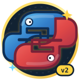

# Python v2 🐍→🐍²

<p align="center">
  
</p>

**I remade Python, but better.**

Python v2 is a programming language that lets you work quickly and integrate
systems more effectively — same energy as the original snake, without the
paper cuts. No indentation errors. Real closures. F-strings that just work.
Structured errors you can actually recover from. A ternary that reads left to
right. And it runs **right in your browser**.

```python
# hello.pyv2
fn greet(name):
    if name == "":
        return "Hello, stranger!"
    end
    return f"Hello, {name}!"
end

numbers = [2, 4, 6, 8]
product = 1
for number in numbers:
    product = product * number
end

print(greet("World"))
print(f"The product is: {product}")
```

```console
$ python3 -m pyv2 hello.pyv2
Hello, World!
The product is: 384
```

## ✨ What makes it better

| Old Python | Python v2 |
|---|---|
| `def foo():` + invisible whitespace | `fn foo():` … `end` |
| `TabError: inconsistent use of tabs and spaces` | No such thing. Ever. |
| `nonlocal` scavenger hunts | closures just work |
| `"n=" + str(n)` | `"n=" + n` |
| `x if ok else y` (backwards) | `ok ? x : y` |
| exception classes for routine app errors | `catch error` gives a useful map; `finally` always runs |
| `assert` is a keyword with moods | `assert(cond, msg)` is a function |
| trailing commas *sometimes* | trailing commas & multi-line everything |
| one runtime | two parity-tested runtimes — CLI **and** browser |
| ad-hoc file access | capability-based app data, atomic saves, and read-only assets |
| packaging guesswork | validated projects, reproducible kits, and real Windows `.exe` builds |

## 🚀 Quick start

### One-click install (language + PyHope engine)

```console
# Windows: download and double-click
install.bat

# macOS / Linux
sh install.sh
```

The readable installer scripts download the latest release, install the
`pyv2`, `pyv2-launcher`, and `pyhope` commands, create a **Python v2 Sudbury**
desktop app/shortcut, and run a self-check. **No pygame, Electron, or
third-party runtime.** Python 3.10+ is the only requirement (some minimal Linux
installs package tkinter separately as `python3-tk`).

### Or run straight from source

```console
$ git clone https://github.com/gefrus112/pythonv2
$ cd pythonv2
$ python3 -m pyv2 examples/fib.pyv2
$ python3 -m pyv2                         # REPL
$ python3 -m pyv2.launcher                # desktop app
$ python3 -m pyhope --demo                # engine demo
$ python3 -m pyv2 examples/games/monster_arena.pyv2
```

## 🏗️ Build production Windows applications

Python v2 now includes the **Sudbury Build Tools**: app metadata, strict JSON,
command-line arguments, sandboxed UTF-8 files, atomic saves, read-only bundled
assets, native dialogs, validation, integrity manifests, and an inspectable
Windows packaging pipeline.

```console
# Create a complete application project
$ pyv2 new windows-app "Comet Tasks"

# Develop and validate it
$ pyv2 Comet-Tasks/main.pyv2 --add "Ship the app"
$ pyv2 check Comet-Tasks

# Create a reproducible Windows build kit from any operating system
$ pyv2 build Comet-Tasks

# On Windows: build the real one-file Comet-Tasks.exe
> pyv2 build Comet-Tasks --native
```

Each project includes `pyv2app.json`, VS Code tasks, a readable batch builder,
a PowerShell builder, app assets, and a GitHub Actions Windows workflow. Every
build kit vendors the exact Python v2 runtime and hashes its inputs. The actual
`.exe` is produced by PyInstaller **on Windows**; macOS and Linux create
the same reviewable build kit or can use the included Windows CI workflow.
Python v2 never disguises a non-Windows binary as an `.exe`. Generated files
are not Authenticode-signed automatically; public distributors should add their
own protected signing certificate in Windows CI.

Packaged apps store writable data under
`%LOCALAPPDATA%\\PythonV2Apps\\APP-ID`. Absolute paths, traversal, symlink
escapes, oversized text, and writes to bundled assets are blocked by default.
See [`examples/software/comet_notes.pyv2`](examples/software/comet_notes.pyv2).

## 🖥️ Python v2 Sudbury Launcher

Version 1.1 ships Python v2 as its own lightweight desktop application. The
workspace provides Home, Code Studio, a path-safe atomic file service, project
wizard, eight packaged CC0 assets, Games/GPU, detected editor connections,
local settings, docs, a polished offline personal/portfolio/game website
starter, Windows app project generation, and a preview server—all using the
Python standard library. Open it with `pyv2-launcher`,
`pyhope-studio`, or `pyhope --studio`.

## 🎮 PyHope game engine

PyHope is the custom engine bundled with Python v2—not pygame. The portable
Python package includes vectors, sprites, tile maps, collision, fixed-step
scenes, DDA ray casting, and terminal preview rendering. The website adds:

* **Byte Beast Arena** — CPU raycaster with original sprite monsters, AI,
  blaster, health and hit detection
* **Comet Hopper** — original classic-style platformer whose level is
  generated by the Python v2 browser runtime
* **Comet Circuit** — top-down racing with a Python v2-generated track,
  three AI drivers, speed-sensitive steering, road grip, laps, and best times
* **Pocket Arcade** — seven additional playable Canvas games: Neon Blaster,
  Asteroid Drift, Target Blitz, Skybound, Turbo Trail, Snake Byte, and Orb Breaker
* **10 illustrated game launch cards** — every icon opens its game directly
* **9M GPU Lab** — 1280×720 live WebGL2 raycaster plus an opt-in
  4096×2304 frame: **9,437,184 ray-cast pixels**
* **Free CC0 sprites** — original hero, monsters, weapon and collectible;
  not copied from Mario, Nintendo, or another game

Play everything at [`games.html`](games.html).

## 🌐 The website

The website lives at the **repo root** (so GitHub Pages serves it directly
at [gefrus112.github.io/pythonv2](https://gefrus112.github.io/pythonv2/)) —
styled after python.org, then pushed further:

* a **runnable playground** in the hero (the real interpreter,
  `pyv2.js`, running in your browser — press the yellow `>_` badge)
* a **Downloads page** (`download.html`) — install the language on
  macOS / Linux / Windows / any editor
* a **dual-runtime Playground** (`playground.html`) — Python v2, an honestly
  labeled Classic Python compatibility subset, command history, separate error
  terminal, downloadable source, and a live personal/portfolio/game website
  studio with generated HTML inspection
* a **tutorial** (`tutorial.html`) — 10 runnable lessons, sandbox included
* a **10-game arcade** (`games.html`) with shooters, platformers, racing,
  Snake Byte, Orb Breaker, animated sprites, Python v2 source, and the 9M GPU lab
* a **50-topic field guide** (`guide.html`) from hello-world to ray casting
* smooth, accessible **reveal-on-scroll animations**, reading progress, and
  back-to-top navigation (respects reduced-motion settings)
* the refreshed **two-snake comet icon** (`logo-v2.svg`, `favicon-v2.svg`) —
  one red snake and one blue snake, interlocked in a gold-rimmed badge
* a full **documentation site** (`docs.html`) covering the language, editor
  setup, and PyHope API
* a YouTube milestone campaign for
  [@CubeCometYT](https://www.youtube.com/@CubeCometYT): the full installation
  video releases at 1,000 subscribers

Serve it locally:

```console
$ python3 -m http.server 8000
# → http://localhost:8000
```

**GitHub Pages** serves the same files from the repo root — push to `main`
and the live site updates at https://gefrus112.github.io/pythonv2/

## 🧑‍💻 Editor setup

Full guides live in [`docs.html`](docs.html) and [`download.html`](download.html) — VS Code, dev
containers / GitHub Codespaces, desktop terminals, and any other editor.
The short version:

| Where | How |
|---|---|
| **Desktop** | `python3 -m pyv2 file.pyv2` — nothing to install |
| **VS Code** | open the repo, hit `Ctrl+Shift+B`; syntax highlighting from `editors/vscode` |
| **Dev containers / Codespaces** | open in container via `.devcontainer/devcontainer.json` — everything preinstalled |
| **Any editor** | associate `*.pyv2`, run `python3 -m pyv2 $file` |

## 🧪 Tests

```console
$ python3 -m unittest discover -s tests -t .
```

**112 tests pass:** 67 language tests, 9 PyHope engine tests, 14 production-app/build tests,
13 workspace/Launcher tests, 8 arcade/Playground site tests, plus a parity harness that runs 28 programs (including error paths) through both the
Python and JavaScript runtimes and demands byte-identical output.

## 📦 Repo layout

```
index.html       home website (GitHub Pages serves this) — quick runner + game
playground.html  dual-runtime editor, commands, errors, website workshop
playground.js    Playground sessions, templates, terminals, and HTML export
classic-python.js documented classic-syntax compatibility translator
download.html    one-click installers + desktop/editor setup
docs.html        language reference + complete PyHope API guide
tutorial.html    10 runnable language lessons + browser sandbox
guide.html       50 concise language/engine learning topics
games.html       10-game arcade, GPU lab, animated sprites, Python v2 source
arcade.js         seven-game shared Canvas engine for Pocket Arcade
pyv2/            interpreter, safe app runtime, Windows builder, CLI, desktop Launcher
pyhope/          engine, CLI, and packaged offline CC0 asset library
pyv2.js          twin language runtime in JavaScript
game.js          CPU sprite raycaster (monsters + weapon)
gpu-game.js      WebGL2 raycaster (9,437,184-pixel mode)
games.js         Comet Hopper + game page controllers
site.js          shared scroll animation/progress behavior
assets/sprites/  original CC0 hero, monsters, weapon, collectible
install.bat      Windows installer for pyv2 + PyHope
install.sh       macOS/Linux installer for pyv2 + PyHope
editors/vscode/  VS Code syntax highlighting + snippets
examples/games/  playable Python v2 game/source examples
examples/software/ persistent JSON and safe app-data examples
tests/           language, app builder, parity, site, workspace, and engine tests
docs/LANGUAGE.md full language reference & grammar
```

## 📖 Docs

The full language reference lives at
[docs/LANGUAGE.md](docs/LANGUAGE.md) — values, operators, scope rules,
builtins, methods, error kinds and the EBNF grammar. Spoiler: it fits on
one page, because the language was designed to.

## 📜 License

MIT — see [LICENSE](LICENSE). The original sprite pack in
`assets/sprites/` is additionally released under CC0. Not affiliated with the
PSF, Nintendo, or pygame. Made with stubborn optimism, CPU pixels, and one
very optional GPU benchmark.
